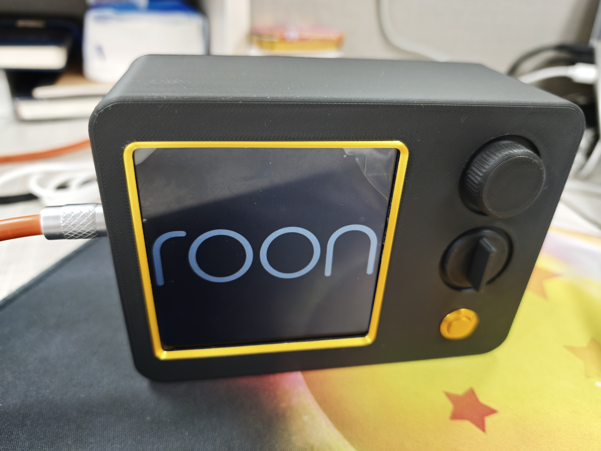
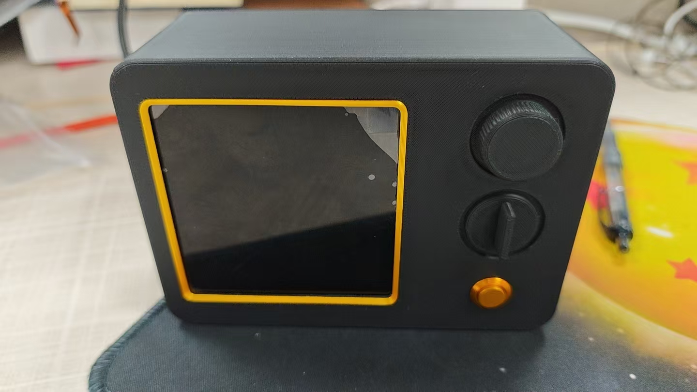
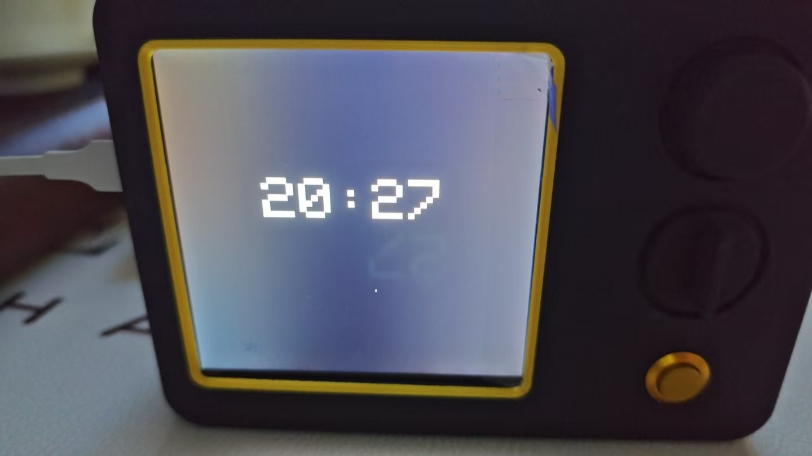
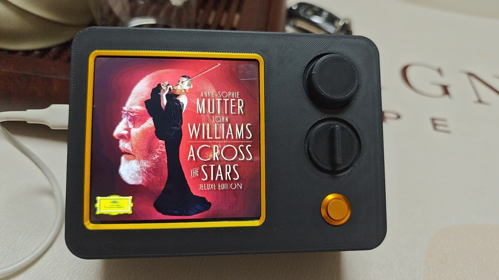
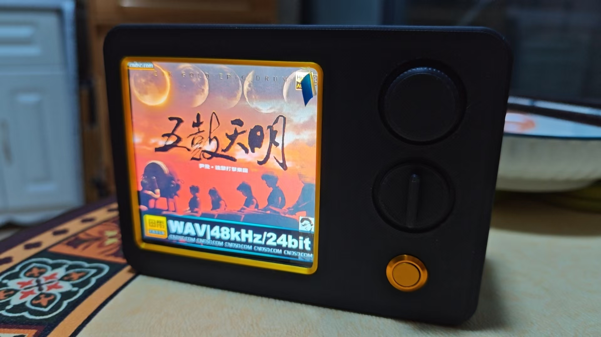
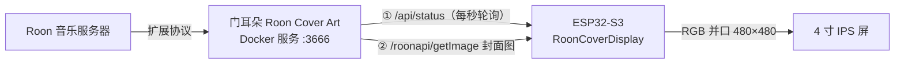

<div align="center">



# Roon Cover Display — ROON 桌面专辑封面显示器

**基于 ESP32-S3 的 Roon 桌面专辑封面小摆件：正在播放 → 全屏封面，停止播放 → 自动变时钟**

[](LICENSE)
[](https://docs.waveshare.net/ESP32-S3-LCD-4/?variant=ESP32-S3-LCD-4)
[](https://www.arduino.cc/)
[](https://github.com/epochaudio/RoonCoverArt_Square_Frame_Docker)

</div>

> English: A desktop now-playing display for [Roon](https://roonlabs.com/), built on a Waveshare ESP32-S3-Touch-LCD-4 (V4, non-touch). It shows full-screen album art while music plays and switches to an NTP clock after 15s idle. It depends on the open-source **Roon Cover Art Extension** service by 门耳朵 (Epoch Audio).

---

## ✨ 效果演示

| 外观 | 时钟模式 |
| :---: | :---: |
|  |  |

| 播放中 | 更多效果图 |
| :---: | :---: |
|  |  ·  |

## 🔔 重要说明：本项目的核心依赖是「门耳朵」开源服务

本项目**不直接连接 Roon**，而是依赖局域网内运行的 **[门耳朵（Epoch Audio）Roon Cover Art Extension](https://github.com/epochaudio/RoonCoverArt_Square_Frame_Docker)** 开源服务：

- 该服务负责与 Roon 服务器通讯，并对外提供两个接口：
  - `GET /api/status` —— 当前播放状态（歌名、是否播放中、image_key 等）
  - `GET /roonapi/getImage?image_key=xxx&albumName=xxx` —— 获取当前曲目的专辑封面
- 本显示器（ESP32）每秒轮询一次状态，发现切歌就立刻拉取新封面，1~3 秒内完成切换。
- **请先部署该服务，再使用本项目**，部署步骤见下文 [依赖服务部署](#-依赖服务部署门耳朵-roon-cover-art)。

感谢门耳朵的开源服务，本项目只是它的一个"显示终端"。

## 🎯 功能特性

- 🖼️ **全屏封面**：播放中实时显示当前曲目专辑封面，切歌 1~3 秒内切换
- 🕐 **智能时钟**：停止播放 15 秒后自动切换为大号时钟 + 中文日期星期（NTP 对时，国内阿里云源）
- ⏻ **电源键关机**：长按 BAT-PWR 3 秒关机（电池供电=真断电；USB 供电=深度待机，再按唤醒）
- 🔁 **断线自愈**：WiFi 断线非阻塞重连、服务器失联 10 分钟自动重启恢复，界面永不卡死
- 🛡️ **稳定性设计**：下载超时/卡死保护、JPEG 数据校验、失败自动重试、启动永不黑屏卡死
- 🔋 **电压监测**：每小时通过串口打印电池电压（调试用）

## 🧩 系统架构



## 🛒 硬件清单

| 项目 | 参数 |
|------|------|
| 开发板 | 微雪 ESP32-S3-Touch-LCD-4 **V4 非触摸版** |
| 处理器 | ESP32-S3-N16R8，双核 240MHz |
| 屏幕 | 4 寸 TFT，480×480，ST7701 驱动（RGB 并行接口） |
| 存储 | 16MB Flash + 8MB PSRAM |
| 连接 | WiFi 2.4GHz |

> ⚠️ 板载电源键说明：短按 BAT-PWR 开机、长按 3 秒关机、RESET 键复位。详细原理见 [docs/power-button.md](docs/power-button.md)。
> 
> 开发板 wiki：[微雪 ESP32-S3-Touch-LCD-4 官方文档](https://docs.waveshare.net/ESP32-S3-LCD-4/?variant=ESP32-S3-LCD-4)

## 🚀 依赖服务部署（门耳朵 Roon Cover Art）

**第 1 步：Docker 部署**（在你的 NAS / 服务器 / N1 等设备上，与 Roon 同一局域网）

```bash
docker pull epochaudio/coverart:3.1.8     # 或 epochaudio/coverart:latest

# 准备目录与配置
mkdir -p /cache/Roonart/images /cache/Roonart/config
cd /cache/Roonart
test -f config.json || printf '{}\n' > config.json
test -f config/local.json || printf '{\n  "server": {\n    "port": "3666"\n  }\n}\n' > config/local.json

docker run -d \
  --name roon-coverart \
  --network host \
  --restart unless-stopped \
  -v $(pwd)/config.json:/app/config.json \
  -v $(pwd)/config/local.json:/app/config/local.json:ro \
  -v $(pwd)/images:/app/images \
  epochaudio/coverart:3.1.8
```

**第 2 步：在 Roon 中启用扩展**

1. 浏览器访问 `http://服务IP:3666` 确认服务已启动
2. Roon → 设置 → 扩展（Extensions）→ 启用 **Roon Cover Art Extension**
3. 选择要显示的播放区域（Zone）

> 更多部署方式（docker compose、手动 npm 部署等）请参阅[门耳朵项目主页](https://github.com/epochaudio/RoonCoverArt_Square_Frame_Docker)。

## 📲 快速开始（显示端）

### 1. 准备 Arduino IDE

安装 [Arduino IDE](https://www.arduino.cc/en/software) 并安装 ESP32 板支持包（开发板管理器搜索 **esp32** by Espressif Systems）。

### 2. 安装库（工具 → 管理库）

| 库名 | 作者 | 用途 |
|------|------|------|
| **LovyanGFX** | lovyan03 | 屏幕显示驱动 |
| **ArduinoJson** (v7.x) | bblanchon | JSON 解析 |
| **U8g2** | olikraus | 中文字体引擎 |
| **U8g2_for_Adafruit_GFX** | olikraus | U8g2 与 LovyanGFX 适配层 |

### 3. 开发板配置（已验证的编译配置）

若开发板列表里有微雪板型（国内镜像版 esp32 核心包含有），直接选择：

```
工具 → 开发板 → Waveshare ESP32-S3-Touch-LCD-4
工具 → USB CDC On Boot → Enabled
工具 → Partition Scheme → Huge APP (3MB No OTA/1MB SPIFFS)
工具 → PSRAM → Enabled
```

> 若列表中没有微雪板型，选通用板型完全等效：
> **ESP32S3 Dev Module** + PSRAM: **OPI PSRAM** + USB CDC On Boot: **Enabled** + Partition Scheme: **Huge APP (3MB NO OTA/1MB SPIFFS)**

### 4. 配置 WiFi 与服务器

将 `wifi_config.example.h` 复制一份，重命名为 `wifi_config.h`，填入你的信息：

```cpp
#define WIFI_SSID     "你的WiFi名"       // WiFi 名称（仅支持 2.4G）
#define WIFI_PASS     "你的WiFi密码"     // WiFi 密码
#define SERVER_HOST   "x.x.x.x"         // 门耳朵 RoonCoverArt 服务器的 IP
#define SERVER_PORT   3666              // 端口（默认 3666）
```

> 🔒 `wifi_config.h` 已在 `.gitignore` 中，不会被提交到 GitHub，密码不会泄露。

### 5. 上传

打开 `RoonCoverDisplay.ino`，点击上传。上电流程：**开机 Logo → 连 WiFi → 连接 RoonCoverArt → 全屏封面**。

## ⚙️ 可调参数

都定义在 `RoonCoverDisplay.ino` 顶部，按需修改：

| 参数 | 默认值 | 说明 |
|------|--------|------|
| `POLL_INTERVAL` | 1000 | 服务器轮询间隔（毫秒） |
| `IDLE_TO_CLOCK_MS` | 15000 | 停止播放多久后切换时钟 |
| `NTP_SERVER` | ntp.aliyun.com | NTP 对时服务器（备选已内置） |
| `GMT_OFFSET_SEC` | 8×3600 | 时区偏移（默认东八区） |
| `WIFI_REKICK_MS` | 15000 | WiFi 连不上时重新发起连接的间隔 |
| `NO_CONTACT_RESTART_MS` | 600000 | 完全失联多久后自动重启自愈（10 分钟） |
| `DL_TOTAL_TIMEOUT_MS` | 30000 | 单张封面下载总超时 |
| `DL_STALL_MS` | 8000 | 下载中途收不到数据的超时 |
| `PWR_BTN_GPIO` | 16 | 电源按键引脚（对应原理图 SYS_OUT） |
| `PWR_OFF_HOLD_MS` | 3000 | 长按多久触发关机 |
| `PWR_BOOT_GRACE_MS` | 10000 | 开机后忽略按键的时间（防唤醒误关机） |
| `BATT_LOG_MS` | 60000 | 电池电压串口打印间隔 |

## ⏻ 电源键行为

| 操作 | 行为 |
|------|------|
| 短按 BAT-PWR（关机状态） | 开机（硬件行为） |
| **长按 BAT-PWR 3 秒** | **关机**：电池供电=真断电；USB 供电=深度待机（屏幕熄灭，再按唤醒） |
| 开机后 10 秒内按 BAT-PWR | 忽略（防止唤醒按键误关机） |
| RESET 键 | 硬件复位，重启程序 |

> 出厂固件的默认手势是"双击关机"，本程序改为更符合直觉的"长按 3 秒关机"。实现原理见 [docs/power-button.md](docs/power-button.md)。

## 🐛 常见问题

<details>
<summary><b>点开查看常见问题</b></summary>

**屏幕一直显示 "WiFi..."？**
检查 WiFi 名称密码；本机仅支持 2.4GHz 频段。串口监视器（115200）可看到详细日志。

**屏幕一直显示 "Roon..."？**
门耳朵服务未启动、IP 填错，或 Roon 扩展未启用。先在浏览器访问 `http://服务IP:3666` 确认服务正常。

**时钟时间不对 / 一直等待对时？**
检查网络是否能访问 `ntp.aliyun.com`，可在代码顶部更换 NTP 服务器。

**长按电源键不关机？**
如果插着 USB 线，长按只会进入深度待机（USB 供电时无法切断电源，这是电路设计决定）。拔掉 USB 用电池供电即可真关机。

**每 10 分钟自动重启？**
说明完全连不上服务器（网络断/服务停），属于自愈机制。检查网络与门耳朵服务。

更多排查思路见 [docs/troubleshooting.md](docs/troubleshooting.md)，引脚定义见 [docs/pinout.md](docs/pinout.md)。

</details>

## 📂 项目结构

```
RoonCoverDisplay/
├── RoonCoverDisplay.ino      # 主程序（全部逻辑都在这一个文件）
├── wifi_config.example.h     # 配置模板（复制为 wifi_config.h 后填写）
├── boot_logo.h               # 开机 Logo 图片数据
├── docs/
│   ├── pinout.md             # 引脚定义（V1 触摸版 / V4 非触摸版对照）
│   ├── troubleshooting.md    # 故障排查笔记
│   └── power-button.md       # 电源键实现原理与串口诊断
├── display/                  # 效果图
└── main/                     # LVGL 编辑器工程（未使用，可忽略）
```

## 🐞 调试

串口监视器波特率 **115200**。正常日志示例：

```
Roon Cover Display v3.1 boot...
[PWR] button=HIGH battery=4.12V
WiFi connected, IP: 192.168.x.x
[PWR] long press -> power off
```

## 🙏 致谢 / Credits

本项目的诞生离不开以下优秀开源项目：

| 项目 | 作者 | 说明 |
|------|------|------|
| [Roon Cover Art Extension](https://github.com/epochaudio/RoonCoverArt_Square_Frame_Docker) | **门耳朵 (Epoch Audio)** | ⭐ 本项目的核心依赖服务，负责与 Roon 通讯并提供封面接口 |
| [LovyanGFX](https://github.com/lovyan03/LovyanGFX) | lovyan03 | 强大的显示驱动库 |
| [ArduinoJson](https://github.com/bblanchon/ArduinoJson) | bblanchon | JSON 解析 |
| [U8g2](https://github.com/olikraus/u8g2) | olikraus | 中文字体渲染 |
| [U8g2_for_Adafruit_GFX](https://github.com/olikraus/U8g2_for_Adafruit_GFX) | olikraus | 字体适配层 |
| [微雪 Waveshare](https://docs.waveshare.net/ESP32-S3-LCD-4/?variant=ESP32-S3-LCD-4) | — | 硬件与文档 |

> 本项目在 AI 辅助下开发（DeepSeek / GLM），欢迎 Issue 与 PR。

## 📄 许可证

本项目采用 [MIT License](LICENSE) 开源。

所依赖的第三方项目（门耳朵 Roon Cover Art、LovyanGFX、ArduinoJson、U8g2 等）各自遵循其自身的开源许可证。
